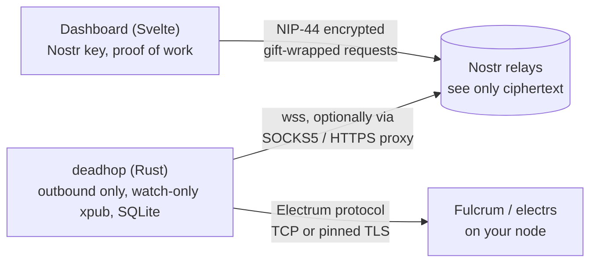

<div align="center">

# deadhop

Accept on-chain bitcoin payments from a service that has no public address.


</div>

## What is this?

deadhop issues bitcoin invoices, watches the chain and reports payments, like a
BTCPay-style server does for simple invoicing. It never listens on a port: customers and
operators reach it only through Nostr relays, using [ContextVM](https://contextvm.org)
(MCP over Nostr), so there is no IP address, HTTP endpoint or login form to attack. It
holds only a watch-only account key and cannot spend.



| Part | What it is |
| --- | --- |
| **Service** (`server/`) | Rust, one binary (about 8 MB), SQLite, no HTTP stack |
| **Dashboard** (`dashboard/`) | Svelte 5 static page. Checkout for customers; for operators: health, statistics and a payment chart, settings, operator keys, start/stop/restart, backups, audit log |
| **Packages** (`packages/`) | `@deadhop/client` (framework-agnostic client and headless checkout), plus pay buttons and invoices in `@deadhop/react`, `@deadhop/solid` and `@deadhop/svelte` (Svelte 5 and 4). npm, and JSR except Svelte |
| **Website and docs** (`site/`) | Astro landing page and VitePress docs under `/docs`, with `llms.txt` and Markdown versions of every page |
| **Security analysis** | [SECURITY.md](SECURITY.md) |

## Quick start (development)

Requirements: Rust 1.88+, Node 22+, Docker, [`just`](https://github.com/casey/just).
Everything runs on loopback against a throwaway regtest chain.

```sh
just install     # once: npm workspace (packages + dashboard) and the Svelte 4 test project
just up          # regtest bitcoind + Fulcrum + private relay, a funded "miner" and a "merchant" wallet
just server      # builds and runs deadhop; writes dashboard/public/config.json
just dashboard   # serves the dashboard at http://127.0.0.1:4173
```

Then, in the browser:

1. Choose **Continue as guest**, enter an amount and choose **Create invoice**. The page
   mines proof of work, then shows the QR code and address.
2. Pay it from the regtest miner wallet (this also mines a block):
   `just pay <address> <sats>`. The page moves to *Payment seen*, then *Paid*.
3. Sign in as an operator to get the dashboard (see below).

`just down` removes the stack and its chain data.

## Development

### Your local settings: `.env.local`

Every dev script (`just up`, `just server`, `just pay`) reads `.env.local` in the project
root on each run. It is gitignored. Put anything you would otherwise retype there:

```sh
# .env.local
DEADHOP_ADMINS=npub1…            # your operator key(s), comma-separated: hex, npub or nprofile
DOCKER_CONTEXT=orbstack         # if the stack runs in a Docker engine other than your default
DEADHOP_TEST_ELECTRUM_HOST=…     # optional: a real Electrum server for `just live-electrum`
DEADHOP_TEST_ELECTRUM_PORT=50002
```

**Operators.** Only operator keys get the dashboard; any other key gets the invoice form.
`just server` makes the keys in `DEADHOP_ADMINS` operators, plus a throwaway test key in
`data/dev/operator.nsec` that the end-to-end tests sign in with. You can also paste that
file's contents into **Paste a secret key**, or add more keys later under
**Settings → Operators**.

### Commands

| Command | What it does |
| --- | --- |
| `just up` / `just down` | Start / remove the regtest stack (bitcoind, Fulcrum, relay) |
| `just server` | Build and run the service against the stack (data in `data/dev/server/`) |
| `just dashboard` | Build the dashboard and serve the production build on port 4173 |
| `just pay <address> <sats> [blocks]` | Pay a regtest invoice and mine blocks |
| `just install` | Install the JavaScript workspace (packages, dashboard) and the Svelte 4 test project |
| `just test` | Unit and integration tests of the service, packages and dashboard; fails below 100% coverage |
| `just e2e` | End-to-end payments on the running stack: dashboard, built client, every framework's components in Chrome |
| `just check` | rustfmt, clippy (warnings are errors), tsc, svelte-check |
| `just packages` | Pack the npm packages, install them into fresh React, Solid, Svelte 5 and Svelte 4 apps, build and type-check those, then publint, attw and a JSR dry run (publishes nothing) |
| `just live-electrum` | Read-only check of a real Electrum server from `.env.local` (pins TLS automatically) |
| `just site` / `just site-preview` | Build and check the website / serve it on port 4330 |

### Tests

| Suite | Tests | Coverage (enforced) |
| --- | --- | --- |
| Rust service (`cargo llvm-cov`) | 143 | 100% lines, 100% functions |
| `@deadhop/client` (`vitest`, v8) | 72 | 100% statements, branches, functions, lines |
| `@deadhop/react` (`vitest`, v8) | 12, plus 1 server-rendering | 100% statements, branches, functions, lines |
| `@deadhop/solid` (`vitest`, v8) | 13, plus 1 server-rendering | 100% statements, branches, functions, lines |
| `@deadhop/svelte`: Svelte 5 and Svelte 4 syntax (`vitest`, v8) | 27, plus 2 server-rendering | 100% statements, branches, functions, lines |
| `@deadhop/svelte/svelte4` on the real Svelte 4 runtime | 15 | n/a |
| Dashboard (`vitest`, v8) | 98 | 100% statements, branches, functions, lines |
| End to end (regtest, real relay, Fulcrum and Chrome) | 21 | n/a |

Unit tests are hermetic: an in-process relay, a scripted Electrum server (plain and TLS),
and in-process SOCKS5, HTTP and HTTPS proxies. Region coverage in Rust is about 98.9%; the
rest is the error side of `?` on calls that never fail in tests.

### Project structure

```
deadhop/
├── dashboard/         Svelte 5 dashboard
│   ├── deploy/        nginx.conf and config.sh for the dashboard image
│   ├── e2e/           end-to-end tests (payment, management, browser)
│   ├── public/        config.example.json (config.json is generated in development)
│   ├── scripts/       keygen.mjs
│   └── src/           components/, lib/ (API client, schemas, proof of work, signer)
├── deploy/            docker-compose.yml for the development stack only
├── packages/
│   ├── client/        @deadhop/client: connection, validation, proof of work, checkout, QR (npm + JSR)
│   ├── react/         @deadhop/react (npm + JSR)
│   ├── solid/         @deadhop/solid (npm + JSR)
│   ├── svelte/        @deadhop/svelte: src/svelte5, src/svelte4, test-svelte4/ (npm)
│   ├── shared/        styles.css, test fixtures and build helpers the three share (not published)
│   └── e2e/           every framework's PayButton paying on regtest in Chrome (not published)
├── scripts/           dev-up.sh, dev-server.sh, dev-pay.sh, lib.sh, check-packages.sh
├── server/            Rust service
│   ├── src/           app, config, db, electrum, keyholder, manage, mcp, pow, relay, service, settings, …
│   ├── tests/         binary tests, live Electrum test, fixtures/
│   └── Dockerfile     service image (entrypoint.sh publishes the public key)
├── site/              Astro landing page and VitePress docs (docs/)
├── compose.yaml       production deployment (service, offline wallet, dashboard)
├── deno.json          Deno workspace, for JSR publishing
├── justfile
├── README.md
└── SECURITY.md
```

## Add payments to your own app

`@deadhop/client` and the framework packages put invoices and pay buttons into an existing
React, Solid, Svelte 5 or Svelte 4 app, against your own deadhop service or someone
else's. All a page needs is the service's public key and a relay it listens on:

```tsx
import { createDeadhop } from '@deadhop/client';
import { PayButton } from '@deadhop/react';   // or @deadhop/solid, @deadhop/svelte, @deadhop/svelte/svelte4

const deadhop = createDeadhop({ serverPubkey: 'npub1…', relays: ['wss://relay.example.com'] });
<PayButton client={deadhop} amount={5000} onPaid={(inv) => console.log(inv.id)} />;
```

The browser can create invoices itself (`DEADHOP_PUBLIC_INVOICING=true`, with proof of
work), or your backend creates them with an operator key and the page only shows them.
Either way, fulfil orders only after your backend has checked the invoice with
`getInvoice(id)`. The full guide, with the service settings each setup needs:
[site/docs/integrate.md](site/docs/integrate.md).

## Production

### 1. Build

```sh
cd server && cargo build --release          # → server/target/release/deadhop
cd dashboard && npm ci && npm run build      # → dashboard/dist/
```

### 2. Configure the service

All configuration is environment variables; nothing has a network-reaching default. At
least one of `DEADHOP_ADMINS` or `DEADHOP_PUBLIC_INVOICING=true` is required.

| Variable | Default | Meaning |
| --- | --- | --- |
| `DEADHOP_RELAYS` | required | Comma-separated `wss://` relay URLs (up to 8) |
| `DEADHOP_ELECTRUM` | required | Electrum server: `host:port` (plain TCP) or `tls://host:port` |
| `DEADHOP_ELECTRUM_CERT_SHA256` | none | Pinned TLS certificate fingerprint(s), comma-separated |
| `DEADHOP_XPUB` | see below | Your wallet's BIP-84 **account** key (`xpub`/`zpub`; `tpub`/`vpub` on test networks). Unset: one is generated (Compose) |
| `DEADHOP_XPUB_FILE` | none | Read the account key from this file when `DEADHOP_XPUB` is unset (the wallet service writes it) |
| `DEADHOP_NETWORK` | `bitcoin` | `bitcoin`, `testnet`, `signet` or `regtest` |
| `DEADHOP_ADMINS` | none | Operator keys, comma-separated: hex, `npub` or `nprofile` |
| `DEADHOP_PUBLIC_INVOICING` | `false` | Let non-operators create invoices (with proof of work) |
| `DEADHOP_POW_BITS` | `20` | NIP-13 difficulty for non-operators |
| `DEADHOP_POW_WINDOW_SECS` | `600` | Accepted age / clock skew of a request |
| `DEADHOP_MIN_CONFIRMATIONS` | `1` | Confirmations before `confirmed` |
| `DEADHOP_DEFAULT_EXPIRY_SECS` / `DEADHOP_MAX_EXPIRY_SECS` | `3600` / `86400` | Invoice lifetime |
| `DEADHOP_MIN_AMOUNT_SAT` / `DEADHOP_MAX_AMOUNT_SAT` | `1000` / `100000000` | Invoice amount bounds |
| `DEADHOP_MAX_OPEN_INVOICES` / `DEADHOP_MAX_INVOICES_PER_DAY` | `500` / `2000` | Caps before the public is refused |
| `DEADHOP_RATE_GLOBAL_PER_MIN` / `DEADHOP_RATE_PER_KEY_PER_MIN` | `30` / `6` | Public invoice-creation budget |
| `DEADHOP_RATE_REQUESTS_PER_MIN` / `DEADHOP_RATE_REQUESTS_PER_KEY_PER_MIN` | `1200` / `120` | Budget for all public tool calls |
| `DEADHOP_POLL_SECS` / `DEADHOP_LATE_GRACE_SECS` | `10` / `86400` | Chain polling; how long expired invoices are still watched |
| `DEADHOP_PROXY` | none | Proxy for relay connections only: `socks5://`, `https://` or `http://`, optionally `user:pass@` |
| `DEADHOP_PROXY_LOCKED` | `false` | Refuse proxy changes from the dashboard |
| `DEADHOP_DATA_DIR` | `data` | Database, backups and the service's Nostr key (created `0700`) |
| `DEADHOP_NAME` | `deadhop` | Name shown in the dashboard (up to 60 characters) |
| `DEADHOP_ANNOUNCE` | `false` | Publish public discovery announcements |
| `DEADHOP_LOG` | `warn,deadhop=info,contextvm_sdk=off,rmcp=off` | Log filter |

Operators can change most of these at runtime from **Settings**. Those changes are stored
in the database as overrides and survive restarts; *Reset to environment* drops them. The
wallet key, network, Electrum server, data directory and the keys in `DEADHOP_ADMINS` can
only be changed on the host.

On first start the service creates its Nostr identity in `<data dir>/server.nsec` (mode
`0600`) and writes the public key to `<data dir>/server.pubkey`. It refuses to start if
the Electrum server is on another chain, or its certificate does not match the pin.

**Check the xpub before taking real payments.** The service logs its first receive address
(index 0) at startup; confirm that your wallet lists that exact address. A wrong account
key (for example BIP-49 instead of BIP-84) still produces valid addresses your wallet will
not show.

### 3. Connect to your Electrum server

Use your own Fulcrum or electrs. On the same machine, plain `host:port` is fine. Across a
network, use the TLS port and pin its certificate:

```sh
deadhop fingerprint node.lan:50002     # prints the certificate's SHA-256 and the two settings below
DEADHOP_ELECTRUM=tls://node.lan:50002
DEADHOP_ELECTRUM_CERT_SHA256=<that fingerprint>
```

The command trusts whatever answers, so compare the fingerprint with the certificate on
the node (`openssl x509 -in <fulcrum cert> -noout -fingerprint -sha256`). A pinned
certificate is accepted whatever its name or issuer (fine for self-signed Fulcrum
certificates), but the server must prove it holds its key. List two fingerprints while
rotating. `tls://` without a pin checks against the public authorities.

### 4. Run it with Docker Compose

[`compose.yaml`](compose.yaml) builds and runs the service, an offline wallet service and
the dashboard:

```sh
DEADHOP_ELECTRUM=tls://node.lan:50002 DEADHOP_ELECTRUM_CERT_SHA256=<fingerprint> \
DEADHOP_ADMINS=<npub> docker compose up -d --build
docker compose exec wallet deadhop wallet export    # write the 24 words down, keep them offline
```

- **Wallet.** Without `DEADHOP_XPUB`, the `wallet` service generates a wallet on first start.
  It has no network at all, keeps the recovery phrase in its own `cvmpay-wallet` volume and
  gives the payment service only the public key. `deadhop wallet export` prints the words
  and how to restore them in any wallet app (Sparrow, BlueWallet, Nunchuk...) to spend. The
  dashboard warns until you have exported them. Meant for small balances: sweep regularly.
  To use your own wallet instead, set `DEADHOP_XPUB` before the first payment; a database
  that has already handed out addresses refuses to switch keys.

- **Service.** Read-only root filesystem, no capabilities, no published port. State lives in
  the `cvmpay-data` volume (`/data`, mode `0700`). It is healthy once it is connected to its
  relays.
- **Dashboard.** nginx on port 8080 (put your TLS proxy in front). Its `config.json` is
  generated at start from `DEADHOP_RELAYS` (or `DEADHOP_DASHBOARD_RELAYS`) and the service's
  public key. The service container writes that key, and only that key, to the shared
  `cvmpay-public` volume. `deadhop pubkey` prints it on any host.
- **Defaults.** `compose.yaml` passes every variable in the table above to the service; any left unset or empty uses its default. Relays
  default to `wss://relay.contextvm.org`, `wss://nos.lol` and `wss://relay.damus.io`.
  Without `DEADHOP_ELECTRUM` and operators, the service logs the missing variable and
  restarts until they are set.

### 5. Or run it under a supervisor

```ini
# /etc/systemd/system/deadhop.service
[Service]
User=deadhop
EnvironmentFile=/etc/deadhop/env
WorkingDirectory=/var/lib/deadhop
ExecStart=/usr/local/bin/deadhop
Restart=always
NoNewPrivileges=true
ProtectSystem=strict
ProtectHome=true
ReadWritePaths=/var/lib/deadhop
```

If the request loop stops and cannot be brought back, the process exits for the
supervisor to restart it. Backups made from the dashboard are written to
`<data dir>/backups` (newest 10 kept); copy them off the host.

### 6. Hide the service's location

- Route the host through a VPN or Tor, or set `DEADHOP_PROXY` (for example
  `socks5://127.0.0.1:9050` for Tor; `.onion` relays work) for relay connections.
- Set `DEADHOP_PROXY_LOCKED=true` so that someone holding an operator key cannot swap in a
  proxy that reveals your address.
- Allow outbound connections to the relays and the Electrum server only; drop all
  inbound traffic. Use more than one relay, at least one you control.

### 7. Deploy the dashboard

Serve `dashboard/dist/` from any static host over HTTPS, with a `config.json` next to
`index.html` (see `dashboard/public/config.example.json`): the service's public key and
the relays it listens on. Send these headers:

```
Content-Security-Policy: frame-ancestors 'none'
X-Content-Type-Options: nosniff
Referrer-Policy: no-referrer
```

The page has a strict Content-Security-Policy, refuses to run in a frame, and shows the
service key it talks to so customers can compare it with the one you publish. Operators
should sign in with a browser extension and a key used only for this service.

### 8. Website (optional)

```sh
cd site && npm ci && SITE_URL=https://your.domain npm run build && npm run check
```

Serve `site/dist/` statically with the same headers, and `.md` files as `text/markdown`.
`SITE_URL` may include a path when the site lives under one, for example
`https://example.org/deadhop`. The public site is built and deployed to bunny.net (site
`deadhop`) by `.github/workflows/site.yml` on every push to `main` that touches `site/` or
`brand/`; it reads the `BUNNYNET_API_KEY` secret and the `SITE_URL` repository variable
(`https://deadhop.run`). Roll back with `bunny sites deployments publish --previous --force`.

On bunny: `deadhop.run` is a Bunny DNS zone whose apex is a PullZone record for the site,
with a Let's Encrypt certificate and forced HTTPS. An edge rule on the pull zone serves
`*.md` as `text/markdown; charset=utf-8`. A deploy is named after its commit, so after
changing `SITE_URL` push a commit (or redeploy with a new ID): rebuilding the live commit
with different content is refused.

The full checklist is in [SECURITY.md](SECURITY.md#deployment-checklist).

## Documentation

| Resource | Contents |
| --- | --- |
| [SECURITY.md](SECURITY.md) | Threat model, findings and their status, remote-management rules, open risks, checklist |
| [site/docs/how-it-works.md](site/docs/how-it-works.md) | Request path, proof of work, addresses, payment detection, invoice states |
| [site/docs/integrate.md](site/docs/integrate.md) | What every integration shares: the service, who creates invoices, checking payments, proof of work, page security |
| [site/docs/integrate-react.md](site/docs/integrate-react.md), [-solid](site/docs/integrate-solid.md), [-svelte5](site/docs/integrate-svelte5.md), [-svelte4](site/docs/integrate-svelte4.md) | One guide per framework: components, custom UI, server rendering |
| [site/docs/integrate-javascript.md](site/docs/integrate-javascript.md) | The headless checkout, for any other framework or none |
| [site/docs/integrate-backend.md](site/docs/integrate-backend.md) | Operator key, creating invoices on the server, checking payments before fulfilling |
| [site/docs/api.md](site/docs/api.md) | All 17 tools (5 for invoicing, 12 for operators), inputs, outputs, errors |
| [site/docs/configuration.md](site/docs/configuration.md) | Every setting, runtime changes, Electrum TLS, proxy |
| [site/docs/deployment.md](site/docs/deployment.md) | Production deployment and checklist |
| [site/docs/design.md](site/docs/design.md) | Why Electrum, why no HTTP (and so no NIP-98), why watch-only |

## Not built yet

- **Automatic PayJoin / CoinJoin sweep.** The policy (method, threshold, fee cap,
  anonymity set) can be set and is reported as due, but nothing executes it: that needs a
  separate signer with spending keys, which this service deliberately does not have.
- SPV verification (merkle proofs against a header chain) to reduce trust in the
  Electrum server.
- Push notifications instead of polling; webhooks for shop back ends.
- An invoice-only key role, so a shop backend can create invoices without holding a key
  that can also manage the service. Today that takes an operator key.
- Taproot (BIP-86) receive addresses.
